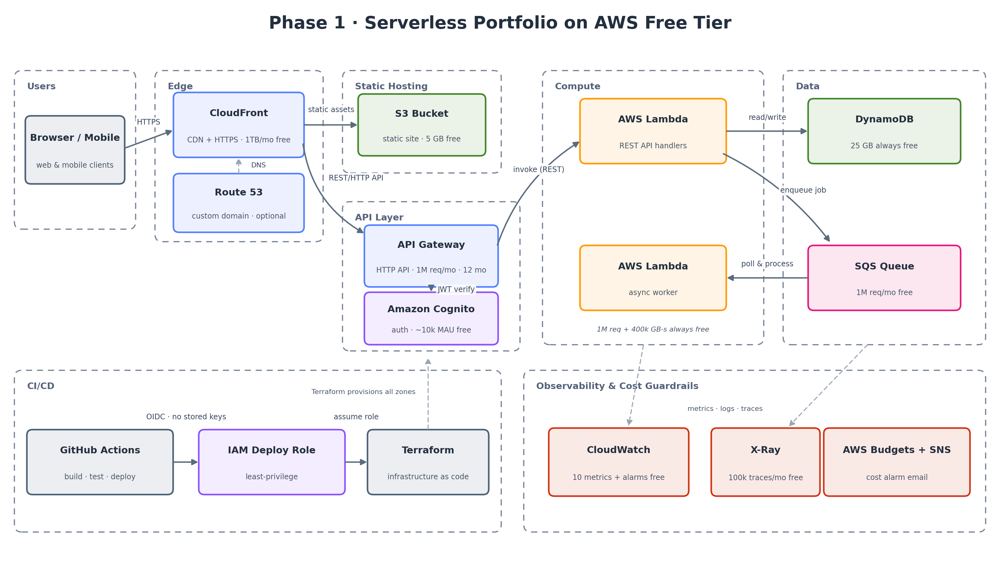
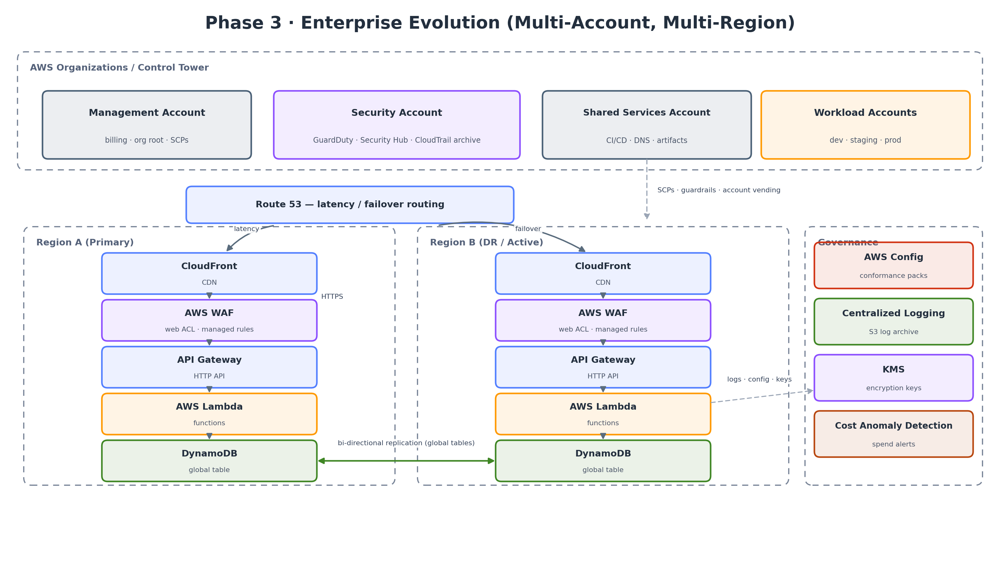

# Serverless Portfolio Platform on AWS

> A production-grade serverless reference architecture that **starts at $0/month on the AWS Free Tier** and is designed from day one to **scale into a multi-account, multi-region enterprise platform** — built with Terraform, GitHub Actions OIDC, and the AWS Well-Architected Framework.



## Why this project exists

Most "serverless portfolio" demos stop at a Lambda behind an API Gateway. This one treats the portfolio site itself as a real product:

- **Phase 0–1** runs entirely inside free-tier / always-free limits with explicit cost guardrails (budgets, anomaly alerts, no NAT Gateway, no idle resources).
- **Phase 2–3** documents a concrete, layer-by-layer evolution path to enterprise: custom domain + WAF, multi-environment CI/CD, AWS Organizations, multi-region DR, governance and FinOps.

The repo is the deliverable: infrastructure as code, CI/CD without stored credentials, architecture decision records, and cost mathematics — the things a cloud architect is actually hired for.

## Architecture at a glance

| Layer | Phase 1 (Free Tier) | Phase 3 (Enterprise) |
|---|---|---|
| Frontend | S3 + CloudFront (OAC) | Multi-region origins, CloudFront + WAF managed rules |
| API | API Gateway **HTTP API** + Lambda | Same shape, + custom domain, usage plans, privateLink where needed |
| Auth | Amazon Cognito (JWT authorizer) | Cognito / IAM Identity Center federation, MFA enforced |
| Data | DynamoDB on-demand (single table design) | DynamoDB **global tables**, PITR, KMS CMK |
| Async | SQS + worker Lambda + DLQ | EventBridge event bus, fan-out, cross-account events |
| Observability | CloudWatch + X-Ray (structured logs, alarms) | Centralized log archive account, SLOs/SLIs, RUM |
| Security | Least-privilege IAM, OIDC deploy role, no long-lived keys | SCPs, Control Tower, GuardDuty, Security Hub, Config conformance packs |
| Cost | $0 target: Budgets + Cost Anomaly Detection | FinOps: CUR, tagging strategy, unit economics |



## Free-tier budget (verify before you build)

AWS changed its Free Tier model in 2025: **new accounts get up to $200 in credits on a 6-month Free plan**, and **30+ services are "Always Free"** within monthly limits on both plans. This architecture is deliberately composed of Always-Free services wherever possible. Full numbers, expiry classes, and known cost traps are documented in [docs/architecture.md](docs/architecture.md) — always confirm against <https://aws.amazon.com/free/> before deploying.

## Repository layout

```
├── .github/workflows/   # CI + deploy via OIDC (no AWS keys in GitHub secrets)
├── infra/               # Terraform: modules/ + envs/{dev,prod}
├── services/
│   ├── api/             # Lambda REST handlers
│   └── worker/          # SQS consumer Lambda
├── web/                 # Static frontend (S3 origin)
├── docs/
│   ├── architecture.md  # Full design doc: phases, scaling paths, cost guardrails
│   └── adr/             # Architecture Decision Records
└── diagrams/            # Architecture diagrams (+ regeneration script)
```

## Getting started

Infrastructure bootstrap (state backend → foundation → CI/CD wiring → first deploy) is documented step-by-step in [infra/README.md](infra/README.md). Lambda unit tests run with `python -m unittest discover` inside `services/api/` and `services/worker/`.

## Roadmap

- [x] Phase 0 — Account foundation & cost guardrails (design)
- [x] Phase 1 — Free-tier serverless MVP (design + diagrams)
- [x] Terraform modules + GitHub Actions OIDC pipeline
- [x] API + worker implementation with tests
- [ ] Phase 2 — Custom domain, WAF, multi-env promotion
- [ ] Phase 3 — Multi-account organization & multi-region DR (reference implementation)

## Key design decisions

1. **HTTP API (v2) over REST API** — lower latency, lower price, native JWT authorizer. → [ADR-0001](docs/adr/0001-http-api-over-rest-api.md)
2. **DynamoDB on-demand, single-table design** — zero idle cost, scales without re-architecture. → [ADR-0002](docs/adr/0002-dynamodb-on-demand-single-table.md)
3. **Terraform + GitHub Actions OIDC** — no long-lived credentials anywhere. → [ADR-0003](docs/adr/0003-terraform-oidc-deploy.md)
4. **No VPC / NAT Gateway in Phase 1** — a NAT Gateway alone is ~$32/month idle; Lambda-to-AWS-service traffic needs no VPC.

---

*Detailed design, phase-by-phase scaling plan, and free-tier mathematics: [docs/architecture.md](docs/architecture.md)*
